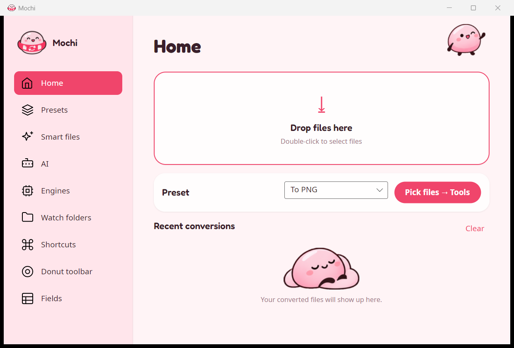
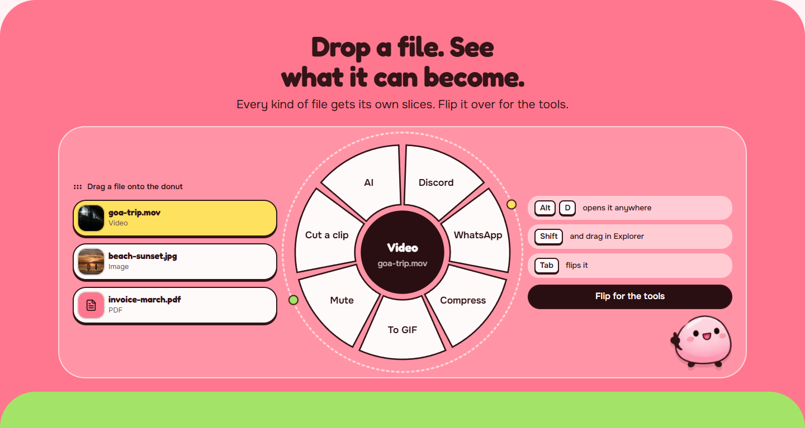
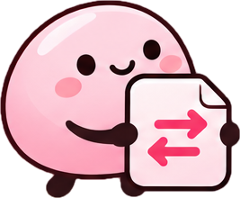
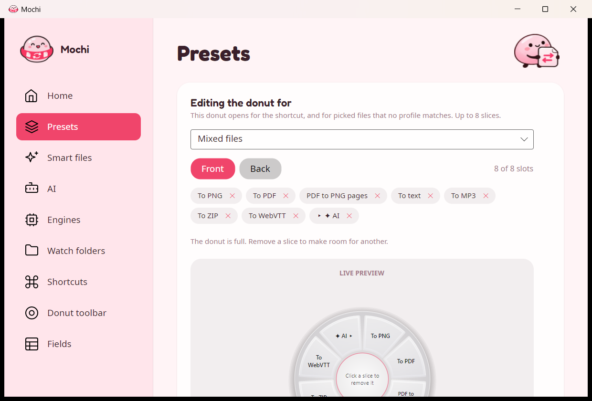
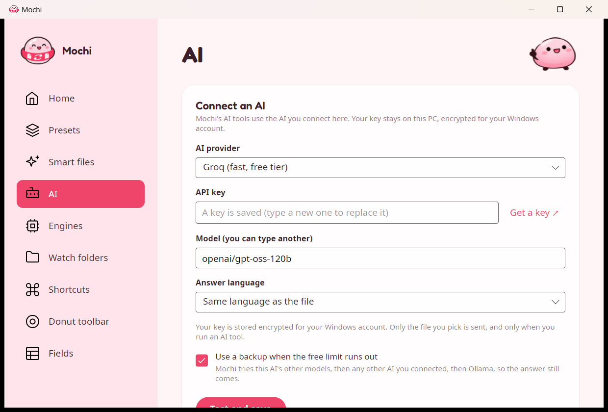
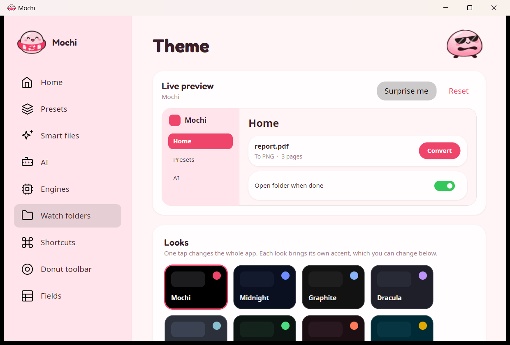
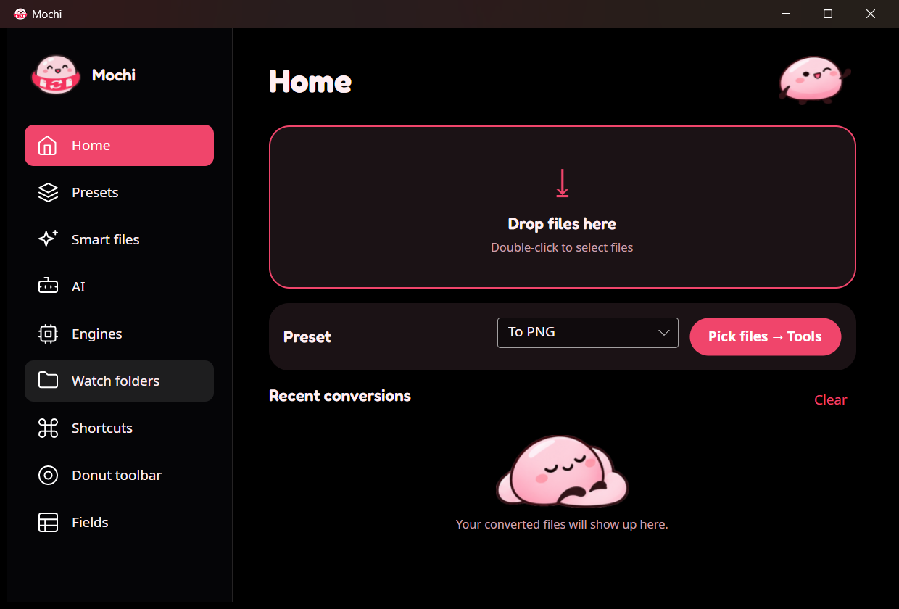
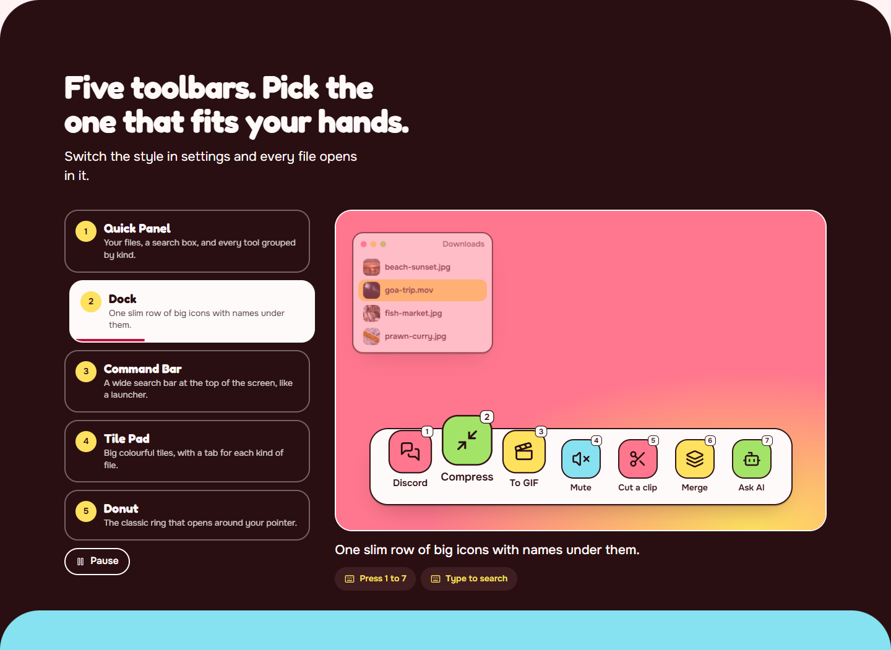
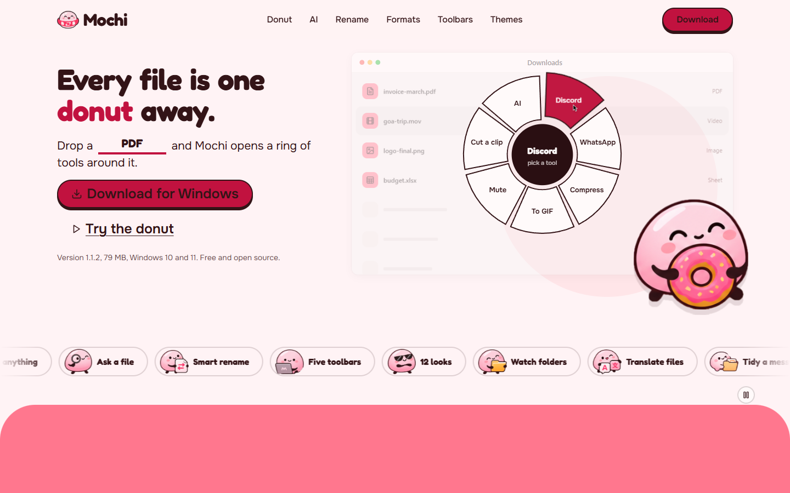

<div align="center">


# Mochi

### Every file is one donut away.

A cute, fast, open-source **file converter for Windows**.<br />
Drop a file and a **donut of tools** opens around it: video, pictures, PDF, documents, AI, and a lot more.

<p>
  <a href="https://mochi.enigmadev.tech"></a>
  
  
  
  <a href="LICENSE"></a>
</p>


<br />



</div>

<br />

## Meet the donut

Press **Alt + D** anywhere, or hold **Shift** while you drag files in Explorer. A ring of tools pops up under your pointer, already filtered to what your files can become.

<table>
<tr>
<td width="50%" valign="top">

- **A profile for every kind of file.** A video gets Discord, WhatsApp, Compress, To GIF, Mute and Cut a clip. A PDF gets Word, Excel, slides, Markdown, Protect and Unlock.
- **Flip it.** **Tab**, **Space** or the mouse wheel turns the donut over to the tools: annotate, PDF pages, perspective crop, sheets, remove background, erase, duplicates.
- **Slices fan out into groups,** bounce in, and light up as you hover.
- **Drop onto a slice** and the result lands next to the original, with a toast that tells you how it went.
- Pick another look when the donut is not your thing: **Quick Panel**, **Dock**, **Command Bar** or **Tile Pad**.

</td>
<td width="50%" valign="top">



</td>
</tr>
</table>

<div align="center"><sub>The same donut, to try in the browser: <a href="https://mochi.enigmadev.tech">mochi.enigmadev.tech</a></sub></div>

<br />

## Everything it does

<table>
<tr>
<td width="33%" valign="top">
<br />
<b>Convert anything</b><br />
38 engines under one donut. Video, audio, pictures, PDF, Office files, e-books, fonts, subtitles, 3D models, CAD, maps, e-mail, archives and data files.
</td>
<td width="33%" valign="top">
<br />
<b>Ask a file</b><br />
Summarise, ask questions, explain a picture, rename smartly, or describe a job in words and let Mochi chain the steps for you.
</td>
<td width="33%" valign="top">
<br />
<b>Smart files</b><br />
Search by meaning ("invoice from March"), tidy a messy folder with a plan and an undo, and find duplicates. Everything runs on your computer.
</td>
</tr>
<tr>
<td valign="top">
<br />
<b>Cosy themes</b><br />
12 looks, light, dark or auto by time, accent swatches, a hue slider, Mica or Acrylic glass, and one-code sharing of a whole look.
</td>
<td valign="top">
<br />
<b>Presets for real life</b><br />
Video for Discord, WhatsApp and e-mail limits, shrink under 1 MB, strip metadata, watermark, long image, pictures to GIF, PDF to Word, and your own.
</td>
<td valign="top">
<br />
<b>Quiet in the background</b><br />
Watch folders convert on arrival. Explorer right-click, one running copy, history that survives restarts, 11 languages, automatic update check.
</td>
</tr>
</table>

<br />

## A look around

<table>
<tr>
<td width="50%"><br /><sub><b>Presets.</b> Shape each donut, with a live preview.</sub></td>
<td width="50%"><br /><sub><b>AI.</b> Bring your own key: Grok, OpenAI, Gemini or Ollama.</sub></td>
</tr>
<tr>
<td width="50%"><br /><sub><b>Themes.</b> Twelve looks and a live preview.</sub></td>
<td width="50%"><br /><sub><b>Dark.</b> Warm cocoa instead of cold black.</sub></td>
</tr>
</table>

<br />

## Five toolbars, one you will like



| Style | What it is | Good for |
| --- | --- | --- |
| **Donut** | The classic ring around your pointer | Mouse people, one-handed use |
| **Quick Panel** | Your files, a search box and every tool by kind | Finding the exact tool |
| **Dock** | One slim row of big icons, keys **1** to **7** | Keyboard people |
| **Command Bar** | A launcher-style search bar at the top of the screen | Typing what you want |
| **Tile Pad** | Big colourful tiles with a tab per kind of file | Nothing to read, just tap |

<br />

## AI that stays on your side

> Connect **Grok**, **OpenAI**, **Gemini**, **Ollama** or any OpenAI-compatible server on the AI page. Keys are kept with **Windows DPAPI**, and **nothing is sent until you run a tool**.

| Tool | What it does |
| --- | --- |
| **Summarise** | A long file in a few lines, streamed into a chat window with follow-ups |
| **Ask this file** | Questions about a PDF, document or sheet |
| **Explain image** | What is in a picture |
| **Smart rename** | Clear names for a batch of files, with a preview and an undo |
| **Do it by typing** | A sentence becomes a checked chain of Mochi presets |

If a free tier runs out, Mochi tries the provider's other models, then your other connected AIs, then Ollama.

<br />

## Install

1. Download **`Mochi-Setup-<version>.exe`** from the [Releases](../../releases) page.
2. Run it. It installs for you alone, **no administrator prompt**.
3. Tick *Explorer right-click* if you want **Convert with Mochi** on every file.

Windows 10 or 11, 64-bit. Self-contained: nothing else to install. Extra engines (FFmpeg, Ghostscript, whisper.cpp and friends) install from the **Engines** page with one click.

### Build it yourself

```powershell
git clone https://github.com/Ayushkumarpatel-AKP/mochi.git
cd mochi
dotnet run --project Mochi            # run the app
installer/build.ps1                    # builds dist/Mochi-Setup-<version>.exe (needs Inno Setup 6)
```

<br />

## Keyboard and command line

| Do this | To get this |
| --- | --- |
| **Alt + D** | Open the donut anywhere |
| **Shift** + drag in Explorer | Open the donut for the files you drag |
| **Tab**, **Space**, mouse wheel | Flip the donut |
| **Ctrl + wheel**, **Ctrl + / -** | Scale the whole window |

<details>
<summary><b>Command line</b></summary>

```
Mochi --convert <preset-id> [--out dir] files…     # no window, prints to the console
Mochi --presets | --engines                        # list what is available
Mochi --page engines                               # open a page at start
Mochi --donut a.png b.pdf                          # open the donut for these files
Mochi [--prompt "…"] --ai ai:summary|ai:ask|ai:explain|ai:rename|ai:command files…
Mochi --annotate pic.png | --pdfedit doc.pdf | --perspective pic.png
Mochi --install <engine-id>                        # same code as the Install button
```

</details>

<details>
<summary><b>The 38 engines</b></summary>

**Built in:** PDF (render, text, merge, split, rotate, pictures to PDF), subtitles, spreadsheets, data (JSON, YAML, TOML, XML, CSV), geo (GeoJSON, KML, KMZ, GPX, Shapefile), fonts (TTF, OTF, WOFF, WOFF2, EOT and Windows bitmap fonts), 3D (STL, OBJ, PLY, picture relief), CAD (DWG, DXF to SVG), archives, e-mail (EML, Outlook MSG), e-books (EPUB, FB2, CBZ), documents (DOCX, MD, HTML, TXT), images, SVG, ICNS, OFD, JPEG XR, crop, perspective crop, trace to SVG, annotate and the PDF editor.

**External, found or installed for you:** FFmpeg, ImageMagick, Ghostscript, Pandoc, LibreOffice, Tesseract, 7-Zip, Calibre, rhwp (HWP), whisper.cpp (captions) and Ollama (local translation).

Checked against independent producers: WOFF2 (fontTools), Outlook MSG (MsgKit), PDF page rotation, HWP, JPEG XR and bitmap fonts.

</details>

<details>
<summary><b>Where things are in the code</b></summary>

| Path | What |
| --- | --- |
| `Mochi/Services/PresetCatalog.cs` | Every built-in conversion (target, options, mode). **Add a preset here.** |
| `Mochi/Services/Engines/*.cs` | One class per engine. **Add an engine** by implementing `EngineBase` and listing it in `Converter.All`. |
| `Mochi/Services/Converter.cs` | Picks the first ready engine, and chains two engines when no single one can. |
| `Mochi/Views/DonutControl.cs`, `DonutWindow.cs` | The donut. |
| `Mochi/Views/MascotView.cs` | The animated Mochi stickers (pop in, hop, squish), driven once per display frame. |
| `Mochi/Services/Ai.cs`, `AiFiles.cs`, `Views/Ai*.cs` | The AI connection, files to text, and the AI windows. |
| `Mochi/Services/ThemeEngine.cs`, `Theme/IosTheme.axaml` | Looks, accent, glass and spacing. |
| `Mochi/Services/Triggers.cs` | Alt + D and Shift-drag. |
| `installer/` | Inno Setup script and build script. |

Settings and logs live in `%APPDATA%\Mochi`.

</details>

<br />

## The website

The download page is a separate project: React, TypeScript, Vite, Tailwind, Motion, GSAP and a 3D Mochi you can squish.



<br />

## Thanks

Mochi is built from **Filee 2.3.0** (MIT licence): its interface strings and What's New slides belong to the Filee authors, and the licence notice for them is in [LICENSE](LICENSE). Conversions lean on the great open-source tools listed above.

<div align="center">

<br />


**Made by [Ayush Kumar Patel](https://github.com/Ayushkumarpatel-AKP). If Mochi saved you a few clicks, a star helps it find friends.**

</div>
